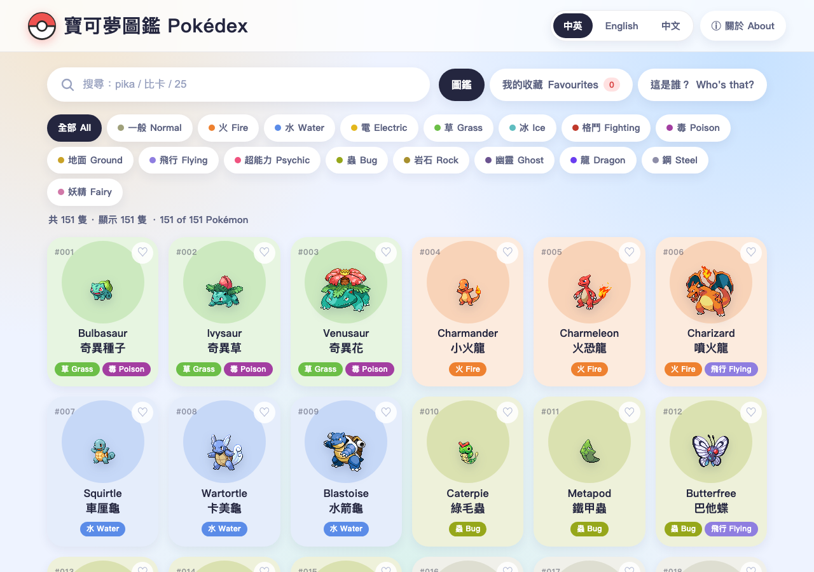
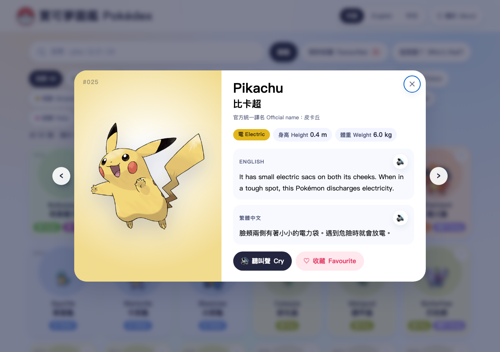

# 寶可夢圖鑑 · Pokédex


給小朋友看的互動圖鑑，收錄第一世代 151 隻寶可夢，英文與繁體中文（香港譯名）對照。
純靜態網站，不需要安裝任何東西，雙擊 `index.html` 就能玩。

**線上版：<https://pokemon.wingleung001.workers.dev>**

這是一個爸爸做給小女兒的專案：她喜歡寶可夢，我們就用它一起看圖、認字、讀英文名。
**非牟利、開源分享**，歡迎下載修改，和你的小朋友一起用。

## 這個專案想說什麼

- **同小朋友一齊做，而不是做給他們。** 選哪隻、名字怎樣叫、字夠不夠大、要加什麼遊戲，都是她一邊看一邊說，我一邊改。她看到自己講過的意見變成畫面，那種「這是我們做的」比任何玩具都實在。
- **興趣是最好的入口。** 她本來就喜歡寶可夢，所以英文名、中文字、屬性、身高體重，全部變成她想知道的東西，而不是要背的東西。
- **想到就做出來。** 由「如果有個圖鑑可以讀給佢聽」到有網址可以分享，中間沒有等廠商、沒有買軟件，只有一個下午和幾句對話。
- **教材可以自己改。** 換成恐龍、海洋生物、中文生字，改的是資料而不是程式。每個家庭都可以有一份為自己小朋友度身訂做的教材。

- GitHub：<https://github.com/twl-dev/pokemon>
- 作者：[tonytsui.io](https://www.tonytsui.io) · 部落格：[wingleung.me](https://www.wingleung.me)
- 故事與授權：[ABOUT.md](ABOUT.md)
- 做法、提示詞與踩過的坑：[MAKING-OF.md](MAKING-OF.md)
- 授權：[MIT](LICENSE)（程式碼）；譯名資料 CC BY-NC-SA 3.0





## 怎麼打開

- **最簡單**：在 Finder 雙擊 `index.html`（用 Safari／Chrome 開啟）。
- 或者開一個本機伺服器：

  ```bash
  cd pokemon
  python3 -m http.server 8000
  # 然後開 http://localhost:8000
  ```

> 圖片與叫聲來自網路（jsDelivr CDN、PokeAPI）。沒有網路時文字仍可瀏覽，圖片會顯示成屬性色圓形佔位。

## 有什麼可以玩

| 功能 | 說明 |
| --- | --- |
| 圖鑑卡片牆 | 151 隻寶可夢，依屬性上色，點卡片看詳情 |
| 中英對照 | 英文名＋香港譯名並列，可切換「中英／English／中文」 |
| 搜尋 | 打英文（`pika`）、中文（`比卡`）或編號（`25`）都可以 |
| 屬性篩選 | 18 種屬性，可與搜尋、收藏一起用 |
| 詳情頁 | 官方插畫、屬性、身高體重、英文與中文圖鑑描述 |
| 朗讀 | 🔊 用語音讀出名字和描述（英文用 en-US，中文優先找粵語 zh-HK，找不到就用 zh-TW） |
| 叫聲 | 播放該寶可夢的叫聲 |
| 我的收藏 | 按 ♥ 收藏，存在瀏覽器裡，下次打開還在 |
| 這是誰？ | 看剪影猜名字，4 選 1，答對有叫聲與計分 |
| 鍵盤 | 詳情頁用 ← → 切換上一隻／下一隻，Esc 關閉 |

小技巧：`index.html?id=25` 可以直接打開比卡超的詳情頁，`index.html?view=quiz` 直接進入猜謎。

## 資料來源

| 來源 | 用途 | 授權 |
| --- | --- | --- |
| [PokéAPI](https://pokeapi.co) | 名稱、圖鑑描述、屬性、身高體重、叫聲 | 免費開放 API，資料源自遊戲 |
| [PokeAPI/sprites](https://github.com/PokeAPI/sprites) | 像素圖、官方插畫 | 圖像版權屬 The Pokémon Company |
| [PokeAPI/cries](https://github.com/PokeAPI/cries) | 寶可夢叫聲 | 同上 |
| [神奇寶貝百科](https://wiki.52poke.com) | 香港譯名 | CC BY-NC-SA 3.0 |
| [jsDelivr](https://www.jsdelivr.com) | 圖片 CDN | 免費 CDN |
| [The Pokémon Company](https://www.pokemon.com) | 名稱與圖像版權持有人 | 商標與著作權所有 |

- 中文圖鑑描述為 PokeAPI 的繁體中文版本；香港譯名與官方統一譯名不同時，詳情頁會以小字標示官方譯名（例如 比卡超／皮卡丘）。
- 寶可夢及相關名稱、圖像為 Nintendo／Creatures Inc.／GAME FREAK inc.／The Pokémon Company 的商標與著作權所有。
- 本專案非牟利，只作個人、非商業的親子與學習用途。

## 重新產生資料

資料檔 `data/pokemon.js` 是自動產生的，不要手動改。要更新或擴充時：

```bash
node scripts/build-data.js
```

腳本會依序：

1. 抓 PokeAPI 的 151 隻資料（名稱、描述、屬性、身高體重、圖片、叫聲）。
2. 抓神奇寶貝百科的香港譯名；若被限流會自動逐隻重試。
3. 檢查筆數與必填欄位，有問題會列出並以非 0 結束。
4. 寫入 `data/pokemon.js`（`window.POKEDEX_DATA`）。

想加入第二世代（152–251），把 `scripts/build-data.js` 最上方的 `LIMIT` 改大再跑一次即可，網站會自動顯示新增的寶可夢。

若某隻的港譯抓錯或抓不到，可在腳本的 `HK_OVERRIDES` 用手動指定：

```js
const HK_OVERRIDES = { 83: '火蔥鴨' };
```

## 部署

純靜態、沒有 build step，任何靜態主機都可以。目前線上版跑在 **Cloudflare Workers（Static Assets）**：

```bash
npx wrangler deploy
```

其他做法：

- **Cloudflare Pages**：Connect to Git → 選這個 repo → Framework preset 選 `None` → Build command 留空 → Build output directory 填 `/`
- **Vercel**：Import repo → Framework Preset 選 `Other` → Build／Output／Install 全部留空
- **本機**：把整個資料夾拖到任何靜態伺服器即可

## 檔案結構

```
pokemon/
├── index.html            版面（含「關於」視窗）
├── styles.css            樣式
├── app.js                互動邏輯
├── data/pokemon.js       自動產生的 151 筆資料
├── scripts/build-data.js 資料產生器（Node 18+，零依賴）
├── ABOUT.md              專案故事、作者、授權與資料來源
├── MAKING-OF.md          做法、提示詞、踩過的坑（給其他家長）
├── LICENSE               MIT（程式碼）＋第三方資料授權說明
└── README.md
```

## 授權

- 程式碼：MIT，可自由使用、修改、再分享。
- 香港譯名資料：CC BY-NC-SA 3.0（來自神奇寶貝百科），轉載請保留出處並以相同方式共享。
- 寶可夢相關名稱與圖像版權屬 The Pokémon Company；本專案非牟利。
